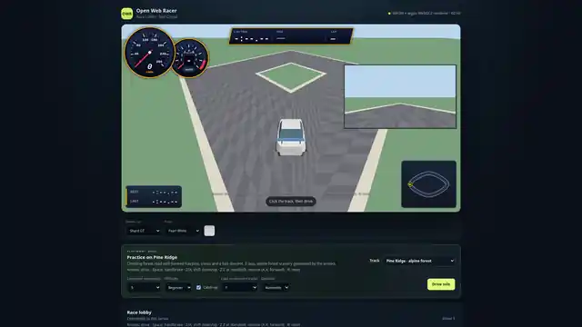
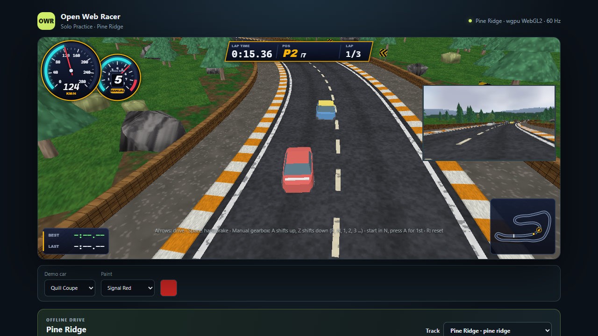
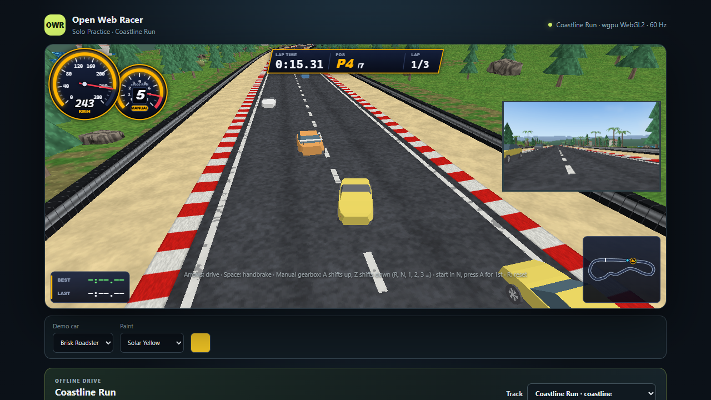
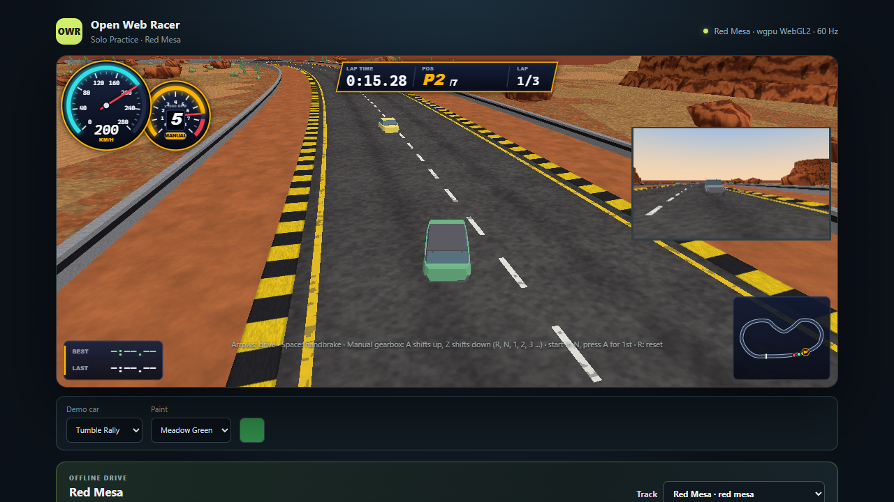
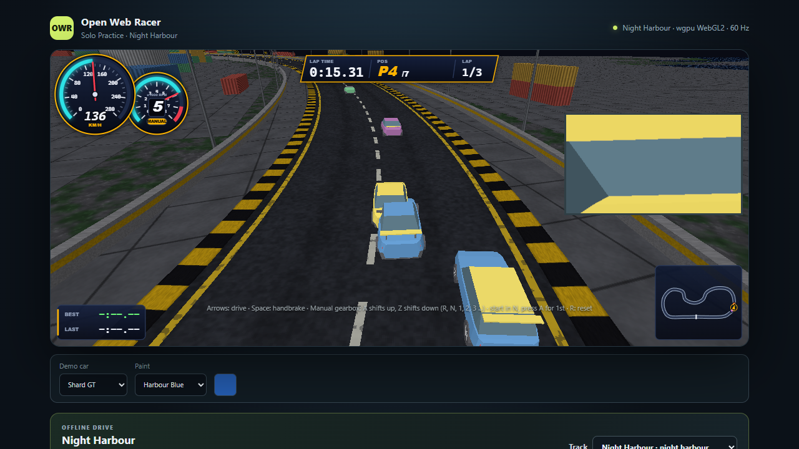
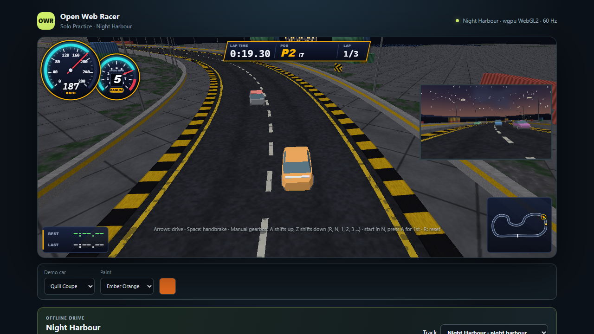
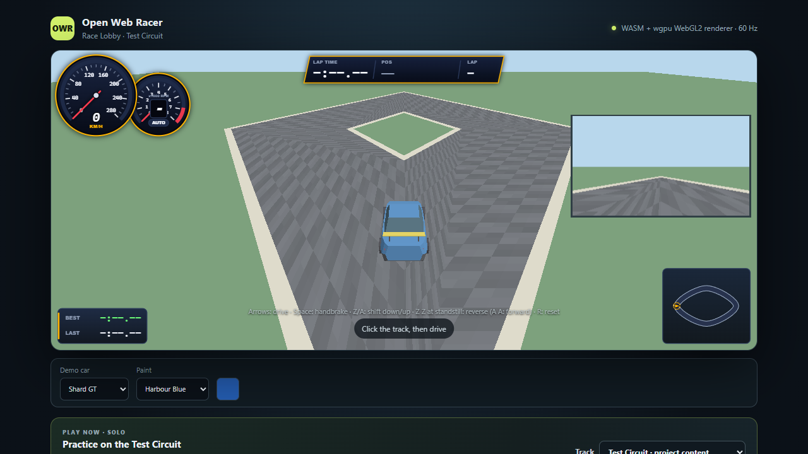

# Open Web Racer

A free, open-source arcade racing game that runs in your browser. Pick a car and a paint colour, pick a track, and race against computer opponents on your own machine, or host a small multiplayer room for friends. The game is written in Rust (compiled to WebAssembly for the browser, plus a Rust server), and all cars, tracks and sounds are generated by code in this repository.



[Watch the demo (MP4, about 36 s)](docs/media/demo.mp4): the menu, choosing a car and a paint colour, then a solo race on Pine Ridge against five computer opponents, from last place to first. Recorded from this build with a scripted autopilot.

| | | |
| --- | --- | --- |
|  |  |  |
|  |  |  |

## Easiest way: let an AI coding agent set it up

If you use an AI coding agent (Claude Code, Codex, Gemini CLI, Cursor, or similar), clone this repository, open it in the agent and ask:

> Set up and run this project, then tell me which URL to open. Follow the README.

The agent can install the Rust toolchain, the WebAssembly target and `wasm-bindgen-cli`, build the client, and start the server for you. It can do the same later for multiplayer ("start the server so my friend on my network can join").

## Set it up yourself

You need:

- Rust (stable) with the `wasm32-unknown-unknown` target. Install from <https://rustup.rs>; the repository's `rust-toolchain.toml` picks the right version and adds the target.
- `wasm-bindgen-cli` at the exact version in `Cargo.lock` (currently 0.2.129): `cargo install --locked wasm-bindgen-cli --version 0.2.129`.
- Node.js 20 or newer (only for the one-command start script and the tests).
- A current Chrome, Edge or Firefox with WebGL2.

Then, from the repository root:

```sh
# Build the browser client and its JavaScript bindings
cargo build -p racer-client --target wasm32-unknown-unknown --release
wasm-bindgen target/wasm32-unknown-unknown/release/racer_client.wasm \
  --target web --out-dir web/pkg --out-name racer_client

# Start the server (it serves the game page and handles multiplayer)
cargo run -p racer-server --release
```

Open <http://127.0.0.1:4173/>. Shortcut: `node scripts/start-dev-server.mjs` does the build steps and starts the server in one go.

A solo race can also be started straight from the address bar, for example:
`http://127.0.0.1:4173/?practice=local&ai=5&track=pine-ridge&car=shard-gt&paint=signal-red&laps=3`

## Solo or multiplayer

**Solo.** On the start page choose "Practice" ("Drive solo"): pick a car, a paint colour, a track, how many computer opponents (0 to 7), their difficulty (Beginner or Advanced), laps, and automatic or manual gearbox. Nothing else is needed, and the race starts at once.

**Multiplayer.** The same server hosts rooms. Open the page, enter a name, choose a track and laps, and click "Create race". Other players open the same address, see your room in the list, join it and press Ready; the race starts after a countdown. Computer opponents can fill empty places.

- On one computer: run the server as above and open two browser windows at <http://127.0.0.1:4173/>.
- With friends on your network: start the server on an address they can reach, for example `RACER_BIND=0.0.0.0:4173 cargo run -p racer-server --release`, and give them `http://<your-computer-address>:4173/`. The default only listens on your own computer. There is no login or encryption, so only do this on a network you trust; see [docs/DEPLOYMENT.md](docs/DEPLOYMENT.md).

## Cars and tracks

**Cars:** Quill Coupe, Brisk Roadster, Tumble Rally and Shard GT. Each has its own shape and its own top speed, grip, steering and gearbox settings.

| Track | Setting |
| --- | --- |
| Pine Ridge | Alpine forest with rock walls and tunnels |
| Coastline Run | Coastal road |
| Red Mesa | Desert canyon |
| Night Harbour | A lit night course at the harbour |

There is also a plain Test Circuit. Eight paint colours are available. All cars and tracks are fictional and generated by this repository.

## Controls

| Key | Action |
| --- | --- |
| Up / Down arrows (or W / S) | Accelerate and brake |
| Left / Right arrows | Steer |
| Z / A | Shift down / up (manual gearbox) |
| Z, Z at a standstill | Engage reverse; A, A returns to forward |
| Space | Handbrake |
| R | Reset the car to the track |
| C | Cycle camera view; hold B to look back |

Click the game once so it has keyboard focus. The page also offers an optional auto-reverse (hold brake at a standstill), mirror and sound settings, and gamepad support (shoulder buttons shift).

## Features

- Server-authoritative simulation at a fixed tick rate, independent of the frame rate; clients predict and interpolate.
- Multiplayer rooms over WebSocket, plus solo practice with up to seven computer-driven opponents.
- Procedural track and car generators with ready-made demo content (cars exported as glTF).
- Automatic or manual gearbox, reverse gear, synthesized engine sound.
- Compact HUD (speed, gear, lap, position, minimap, mirror) and several camera views.
- Content packs and a small plugin API for adding your own tracks, cars and sounds ([docs/CONTENT_PACK.md](docs/CONTENT_PACK.md), [docs/PLUGINS.md](docs/PLUGINS.md)).

## Known issues

- In multiplayer rooms, all cars currently render red: the colour you pick shows in the lobby, but the in-race paint is the default. Solo races use the colour you chose.
- Browser tests (Playwright, Chromium): 49 of 52 pass on a GPU machine; two tests in `tests/e2e/fullscreen.spec.js` fail (the canvas stays hidden after a refused fullscreen request, and on a 320x600 screen the exit button overlaps the HUD in fullscreen), and one reverse-gear room test is occasionally flaky. On a machine with only software rendering, the lobby-preview test in `tests/e2e/project-tracks.spec.js` can also time out. The Firefox project is not run. Unit tests (`cargo test`, `npm test`) all pass.
- Rendering needs WebGL2; software rendering works but is slow.
- The server logs one harmless 404 for the optional `/plugins.json`.

## Tests

```sh
cargo test --workspace --locked
npm test                              # web unit tests
npm install && npm run install:browsers && npm run test:e2e    # browser tests (Playwright)
```

## Repository layout

| Path | Contents |
| --- | --- |
| `crates/sim` | Deterministic vehicle and race simulation |
| `crates/protocol` | Wire protocol shared by client and server |
| `crates/server` | HTTP, WebSocket and race hosting |
| `crates/client`, `crates/render` | Browser client (WebAssembly) and renderer |
| `crates/ai` | Computer-driven opponents |
| `crates/trackgen`, `crates/cargen` | Procedural track and car generators |
| `crates/pack-schema`, `crates/content` | Content pack format and loaders |
| `crates/example-model` | Example of a pluggable vehicle model |
| `web/` | Page, scripts and styles |
| `content/demo/` | Generated demo cars and tracks |
| `docs/` | Architecture, protocol, content packs, plugins, testing |
| `tests/` | JavaScript unit tests and browser tests |

## More documentation

[Architecture](docs/ARCHITECTURE.md) · [Development](docs/DEVELOPMENT.md) · [Testing](docs/TESTING.md) · [Deployment](docs/DEPLOYMENT.md) · [Network protocol](docs/NETWORK_PROTOCOL.md) · [Track generator](docs/TRACKGEN.md) · [AI drivers](docs/AI_DRIVERS.md) · [Legal notes](docs/LEGAL.md)

## Contributing

See [CONTRIBUTING.md](CONTRIBUTING.md). Security reports: [SECURITY.md](SECURITY.md).

## License

Apache License 2.0, see [LICENSE](LICENSE) and [NOTICE](NOTICE). Copyright 2026 Jonny Svahn (Svahnen).
